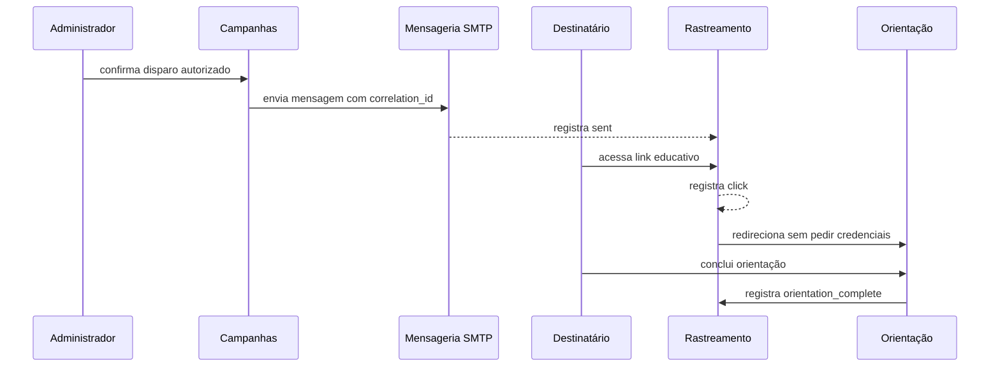

# ADR-002 - Rastreabilidade mínima sem credenciais

- **Status:** Aceita como princípio funcional; implementação-alvo pendente
- **Data:** 2026-10-01

## Contexto

O programa precisa saber se uma mensagem foi enviada, se o link educativo foi acessado e se a orientação foi concluída. O objetivo não é coletar senha, código MFA ou credencial.

## Decisão

Usar um identificador de correlação aleatório por mensagem ou convite e registrar somente eventos necessários à finalidade educativa. A landing page deve permanecer sem campos de autenticação e sem persistência de segredo.

## Consequências

- `sent`, `click` e `orientation_complete` não devem ser interpretados como prova de leitura integral ou de encaminhamento.
- E-mail e setor são PII operacional e precisam de acesso, retenção e exportação controlados.
- A correlação deve ser revogável ou expirar quando a campanha for encerrada.

