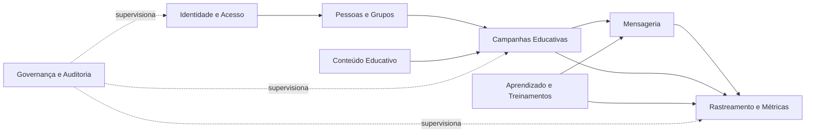

# Proposta inicial de bounded contexts

## Status

Esta é uma proposta inicial para aprovação. O detalhamento de implementação deve seguir um módulo por vez; o primeiro módulo em análise é **Campanhas educativas**.

## Contextos propostos

| Contexto | Responsabilidade | Entidades principais |
| --- | --- | --- |
| Identidade e Acesso | Login administrativo, sessão, autorização e auditoria de acesso. | Administrador, Sessão, Permissão |
| Pessoas e Grupos | Cadastro de participantes, setores, grupos e vínculos. | Pessoa, Setor, Grupo, MembroGrupo |
| Conteúdo Educativo | Layouts de e-mail, páginas de orientação e textos seguros. | Layout, VersãoLayout, Orientação |
| Campanhas Educativas | Orquestração de rascunho, público, revisão, envio e encerramento. | Campanha, DestinatárioCampanha, Disparo |
| Mensageria | Remetente, Reply-To, SMTP, allowlist e entrega. | ConfiguraçãoSMTP, Mensagem, ResultadoEntrega |
| Rastreamento e Métricas | Eventos, correlação, agregações e relatórios. | EventoCampanha, Métrica, Relatório |
| Aprendizado e Treinamentos | Cursos, módulos, avaliações, convites e progresso. | Curso, Módulo, ConviteTreinamento, Progresso |
| Governança e Auditoria | Trilhas de administração, retenção, exportação e revisão. | EventoAuditoria, PolíticaRetenção, Exportação |

## Relações principais

## Decisão de sequência

O primeiro detalhamento será Campanhas Educativas porque esse contexto materializa a finalidade central do produto e depende de Pessoas e Grupos, Conteúdo Educativo, Mensageria e Rastreamento. A aprovação desta divisão não autoriza, por si só, a implementação; ela autoriza o refinamento do contexto escolhido.

