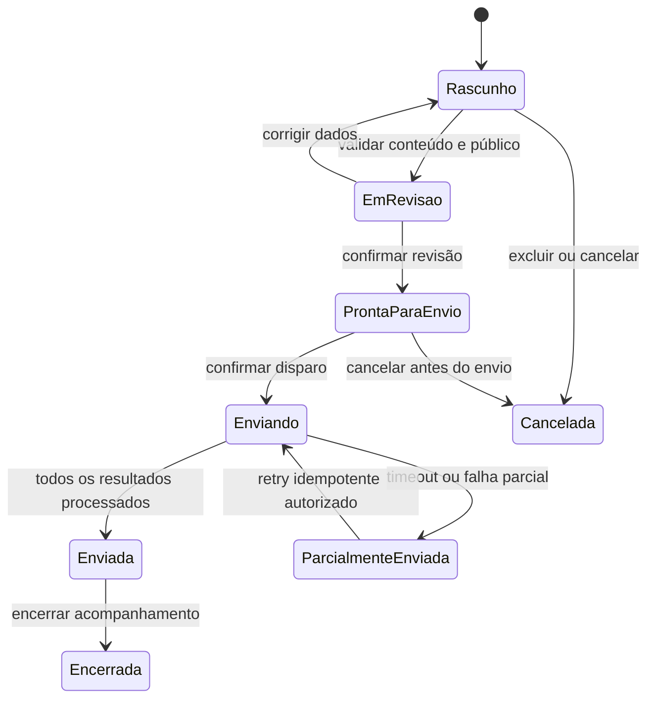
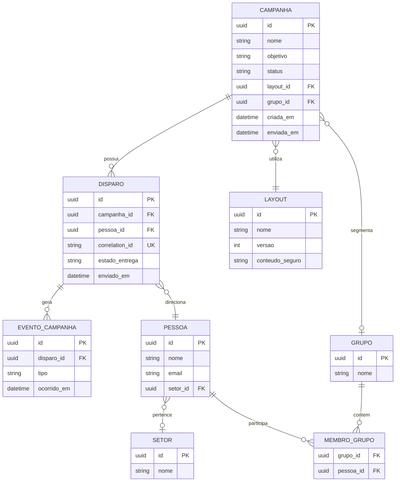
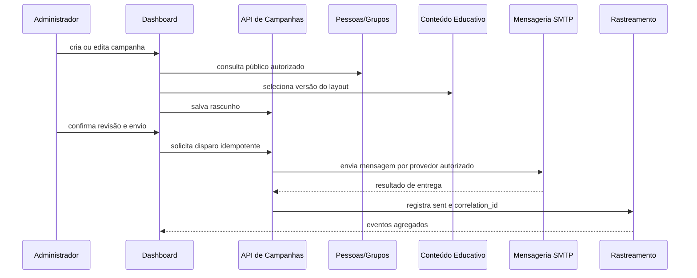

# Requisitos - Campanhas educativas

## Status do documento

- **Módulo atual:** Campanhas educativas
- **Fase:** Refinamento inicial, aguardando validação do responsável
- **Fonte de evidência:** `server.py`, `dashboard.html`, `app.js`, `README.md`
- **Regra:** este documento descreve o comportamento existente e separa os gaps necessários para a arquitetura-alvo.

## Visão geral

Campanhas educativas permitem preparar uma comunicação controlada para destinatários corporativos autorizados, escolher um layout seguro, salvar um rascunho, revisar o assunto e enviar a mensagem por SMTP. A interação pode abrir uma orientação educativa e gerar eventos mínimos para acompanhamento.

O módulo não deve capturar senha, código MFA ou qualquer credencial. A mensagem e a página educativa devem permanecer dentro da finalidade de conscientização autorizada.

## Atores

| Ator | Responsabilidades |
| --- | --- |
| Administrador/Gestor de SI | Autenticar, configurar remetente, cadastrar público, criar layout, criar campanha, revisar, enviar e consultar eventos. |
| Destinatário corporativo | Receber a mensagem, acessar o conteúdo educativo e concluir a orientação voluntariamente. |
| Servidor SMTP corporativo | Autenticar o remetente e aceitar a mensagem para entrega. |
| Serviço de rastreamento | Validar correlação, registrar evento permitido e encaminhar para a orientação. |

## Entidades e invariantes

| Entidade | Propriedades mínimas | Invariantes propostas |
| --- | --- | --- |
| Campanha | `id`, `nome`, `objetivo`, `status`, `layoutId`, `grupoId`, `criadaEm`, `atualizadaEm`, `enviadaEm` | Nome obrigatório; rascunho pode ser editado; campanha enviada não deve alterar o conteúdo que foi disparado. |
| DestinatárioCampanha | `campanhaId`, `pessoaId` ou `email`, `estado` | E-mail válido e pertencente a domínio autorizado; não duplicar dentro do mesmo disparo. |
| Layout | `id`, `nome`, `kicker`, `titulo`, `copia`, `botao`, `logo`, `versao` | Conteúdo sem campo de senha, código MFA ou solicitação de credencial. |
| Disparo | `id`, `campanhaId`, `correlationId`, `destinatario`, `estadoEntrega`, `enviadoEm` | `correlationId` único; segredo SMTP nunca pertence à entidade. |
| EventoCampanha | `id`, `disparoId`, `tipo`, `ocorridoEm` | Tipos limitados a envio, clique e conclusão; evento idempotente por tipo e correlação. |

## Estados da campanha



## Modelo relacional proposto



## Fluxo de integração



## Comportamento atual observado

### Criar e editar rascunho

- A interface cria rascunho com nome, público, dificuldade, grupo, destinatários, layout, tema e objetivo educativo.
- Os destinatários diretos e os destinatários derivados do grupo são normalizados e deduplicados no navegador.
- O rascunho fica no `localStorage`; o servidor ainda não possui um agregado de campanha persistido.
- O layout selecionado é copiado para o payload de envio por texto e modelo.

### Enviar campanha

- O dashboard abre um modal de revisão.
- O assunto pode ser editado, mas o comportamento atual força o prefixo `[SIMULAÇÃO FPAP]`.
- O envio usa `/api/send-campaign`.
- O servidor valida allowlist, remetente, host SMTP, usuário e senha em memória/ambiente.
- O envio é síncrono e produz um `correlation_id` por destinatário.

### Rastrear interação

- O link passa por `/track/click`.
- O servidor registra `click` e redireciona para a landing educativa.
- A conclusão da orientação pode gerar `orientation_complete`.
- O sistema não confirma abertura do e-mail por pixel e não identifica com segurança um encaminhamento.

## Contratos de API atuais

| Método e rota | Acesso | Finalidade | Entrada/saída principal |
| --- | --- | --- | --- |
| `GET /api/health` | Público | Expor saúde e metadados de configuração não secretos. | Retorna `ok`, host de bind, URL pública e flags SMTP. |
| `GET /api/config` | Sessão | Ler configuração do remetente. | Retorna remetente, Reply-To, SMTP sem senha e allowlist. |
| `POST /api/config` | Sessão | Salvar remetente e SMTP. | DTO: `sender_email`, `sender_name`, `smtp_user`, `reply_to`, `smtp_host`, `smtp_port`, `smtp_security`, `allowed_domains`, `smtp_password` transitória. |
| `POST /api/send-test` | Sessão | Enviar mensagem de teste. | DTO: `recipient`, `subject`, `campaign_id`. |
| `POST /api/send-campaign` | Sessão | Disparar campanha. | DTO: `campaign_id`, `campaign_name`, `subject`, `recipients[]`, `layout_template`, `layout_text`. |
| `GET /api/events?campaign={id}` | Sessão | Listar eventos de campanha. | Retorna `events[]`. |
| `POST /api/events` | Sessão | Registrar evento permitido não relacionado a envio. | DTO: `type`, `correlation_id`, `campaign_id`. |
| `GET /track/click?campaign={id}&cid={correlation}` | Público | Registrar clique e redirecionar. | Retorna redirecionamento para landing educativa. |

### Contrato-alvo recomendado

`POST /api/v1/campaigns` deve criar uma campanha versionada e retornar `campaignId`, `status` e `version`. `POST /api/v1/campaigns/{id}/dispatch` deve aceitar uma chave de idempotência e retornar resultados por destinatário, sem expor senha ou segredo SMTP.

## Casos de uso

### UC-01 - Criar rascunho

1. Administrador autenticado abre Nova campanha.
2. Informa nome e objetivo educativo.
3. Seleciona grupo e/ou destinatários válidos.
4. Seleciona layout educativo.
5. Salva como rascunho.

Exceções: nome vazio, e-mail inválido, domínio não autorizado, destinatário duplicado, grupo inexistente ou layout excluído.

### UC-02 - Revisar e enviar

1. Administrador abre um rascunho.
2. Confere assunto, remetente, público, layout e objetivo.
3. Confirma que não há coleta de credenciais.
4. Confirma o disparo.
5. Sistema registra os resultados individuais e atualiza o estado da campanha.

Exceções: sessão expirada, SMTP AUTH recusado, timeout, falha parcial, domínio bloqueado ou campanha já enviada.

### UC-03 - Acompanhar interação

1. Usuário acessa o link educativo.
2. Sistema valida a correlação.
3. Sistema registra clique uma única vez por tipo.
4. Sistema abre a orientação sem solicitar credenciais.
5. Sistema registra conclusão quando o usuário finaliza a orientação.

## Critérios de aceite BDD

### AC-01 - Rascunho persistente

```gherkin
Given um administrador autenticado
And um nome, objetivo, layout e público válidos
When ele salvar a campanha como rascunho
Then a campanha deve aparecer na lista de campanhas
And deve ser possível reabrir e editar o mesmo identificador
```

### AC-02 - Validação de domínio

```gherkin
Given uma allowlist contendo fieam.org.br
When o administrador adicionar um destinatário de domínio não autorizado
Then o sistema deve bloquear o salvamento ou envio
And deve informar qual regra de domínio foi violada
```

### AC-03 - Proteção de credenciais

```gherkin
Given um layout de campanha educativa
When o administrador tentar inserir senha, código MFA ou campo de credencial
Then o sistema deve rejeitar o conteúdo
And nenhuma credencial deve ser armazenada ou enviada
```

### AC-04 - Disparo idempotente

```gherkin
Given uma campanha pronta para envio
When a mesma solicitação for reenviada por timeout do navegador
Then o sistema não deve duplicar o disparo para o mesmo destinatário
And deve retornar o resultado original associado à chave de idempotência
```

### AC-05 - Falha parcial

```gherkin
Given uma campanha com vários destinatários válidos
When o SMTP aceitar alguns envios e recusar outros
Then a campanha deve ficar parcialmente enviada
And o relatório deve separar sucesso, falha e pendência
And o administrador deve poder repetir somente os pendentes
```

### AC-06 - Rastreabilidade mínima

```gherkin
Given uma mensagem enviada com correlation_id
When o destinatário acessar o link educativo
Then o sistema deve registrar um clique para aquela correlação
And deve redirecionar para uma orientação sem campos de senha
```

## Perguntas de refinamento do módulo atual

As perguntas abaixo são deliberadamente restritas a Campanhas educativas, conforme a regra de um módulo por vez.

1. **Fluxo e exceções:** Qual deve ser o comportamento quando uma campanha tiver falha parcial no SMTP: repetir automaticamente, exigir aprovação manual ou encerrar com estado parcial? Qual timeout máximo e quantas tentativas são aceitáveis?
2. **Regras e estados:** Quais estados oficiais a campanha deve possuir e quem pode transicionar de rascunho para pronta, enviada, parcialmente enviada, encerrada ou cancelada?
3. **Segurança e LGPD:** Por quanto tempo e com qual nível de acesso devem ser mantidos e-mails, setor, eventos de clique e resultados por pessoa? Deve existir anonimização após o encerramento?
4. **Integrações:** O envio corporativo será SMTP AUTH/STARTTLS, OAuth2 com Microsoft Graph, ou ambos? Existe fila corporativa, limite por minuto e requisito de auditoria do provedor?
5. **Estrutura de dados:** O público será uma fotografia versionada no momento da revisão ou deverá refletir alterações posteriores em Pessoas/Grupos até o instante do disparo?
6. **Conteúdo:** Quem aprova o texto e o layout antes do envio? É necessário fluxo de aprovação por outro administrador?
7. **Rastreamento:** O indicador de abertura é obrigatório ou o programa aceita somente clique e conclusão, considerando bloqueios de imagens e privacidade dos clientes de e-mail?
8. **Encerramento:** O que acontece com links e eventos quando a campanha é encerrada: continuam válidos, expiram ou exibem uma página educativa genérica?

## Decisões ainda bloqueadas

- Contrato definitivo de persistência e idempotência.
- Política de retenção e anonimização.
- Provedor de mensageria corporativa.
- Matriz de autorização para visualizar dados individuais.
- Aprovação do mapa de bounded contexts.

